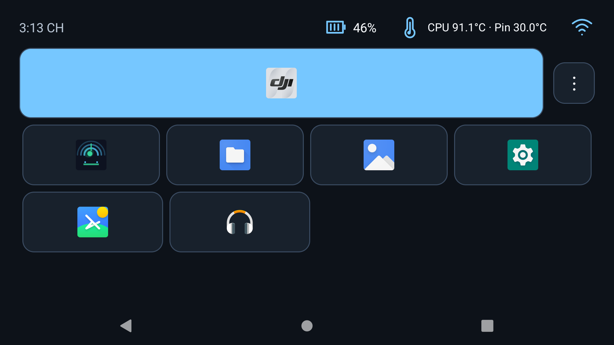

# RC Launcher

Launcher gọn cho DJI RC 2, trong fork Lawnchair 12.1-dev. Bản đang bàn giao: **1.0-preview6**, code 6. Có APK debug cài được và release unsigned. Không phải ứng dụng chính thức DJI/Lawnchair.

Theo điều chỉnh trực tiếp của người dùng, dashboard dùng icon gốc của DJI Fly và các ứng dụng đã cài; thanh trên có giờ, phần trăm pin RC, nhiệt độ pin và Wi-Fi. Đã bỏ hàng Quay lại/Trang chủ RC/Menu RC/Tất cả ứng dụng vì tay đã có thanh Android ba nút. Dịch vụ điều hướng tùy chọn giữ tắt; không yêu cầu bật để dùng dashboard.



## Trạng thái thực tế

- Runtime đã kiểm chứng tới preview5 trên RC331/API30: app icons, Files/Gallery/Fly launch, CPU/Pin. Preview6 giữ giao diện và thêm xử lý lỗi khi OEM từ chối kiểm tra activity; đã build/test nhưng tay đã ngắt USB trước khi cài preview6.
- Gói debug **158.414 byte**, không native library, không dependency AndroidX/Compose/Kotlin trong runtime. Cache icon tối đa 4 MB, bitmap 96px; xóa cache và dừng package/icon/status producers khi dashboard ẩn.
- 24 unit tests gesture/config pass. Debug/release build pass. Lint 0 errors, 33 warnings; không che warnings bằng baseline/suppression.
- PSS dashboard warm đã quan sát **71.053 KB (~69,4 MiB)**; số đo đơn lẻ bản debug, không phải p95/benchmark release. Xem [hiệu năng](docs/performance-report.md).
- Default Home/boot đã được RC2 Việt chuyển qua Homebridge3.0 để mở RC Launcher. APK vẫn hỗ trợ companion; chưa tự giữ trực tiếp HOME role. Lawnchair chỉ là fallback nếu RC app không mở được.
- Điều hướng Trợ năng đã có source nhưng chưa bật/kiểm chứng trên firmware; không tuyên bố global navigation PASS. Người dùng hiện chọn dùng thanh điều hướng Android sẵn có.
- Home và một reboot đã quan sát; chưa thử bay, soak dài hoặc mọi handler của firmware. Xem [matrix](docs/rc2-compatibility.md).

## Build

Windows, JDK 17, Android SDK platform 34 và Gradle wrapper 8.4. Tạo local.properties ngoài Git với sdk.dir của máy. Từ root fork:

```powershell
.\gradlew.bat :rc2:assembleDebug :rc2:assembleRelease :rc2:testDebugUnitTest :rc2:lintDebug --no-daemon
```

Output:

- rc2/build/outputs/apk/debug/rc2-debug.apk: package dev.rclauncher.rc2.debug, Android Debug signer.
- rc2/build/outputs/apk/release/rc2-release-unsigned.apk: package dev.rclauncher.rc2, debuggable=false, R8/shrink. **Chưa ký, không dùng để cài trực tiếp.**
- Gói bàn giao ở artifacts/. Source/keystore production không được nhúng vào APK hay Git.

## Dùng trên tay

Mở biểu tượng RC Launcher hoặc Home đã được thiết lập. Chạm iconFly để mở app đã chọn; giữ để chọn lại. Shortcut hiển thị iconapp có thật, chạm mở đúng component, giữ để ghim. Menu⋮ mở danh sách ứng dụng/cài đặt. Không tự bật FCC hoặc sửa DJI Fly.

Ô Launcher mở cài đặt: chọn app, ngôn ngữ VI/EN, xuất/nhập/reset cấu hình, diagnostics. Cử chỉ toàn hệ thống là tùy chọn; nếu muốn thử, tự bật trong Trợ năng, bật vùng điều hướng và hiệu chỉnh trước khi dùng. Không tự ghi secure settings/cấp service.

[Cài/gỡ/khôi phục](docs/rc2-install-recovery.md) · [Điều hướng](docs/navigation.md) · [Audit nguồn](docs/upstream-audit.md) · [Kiểm thử](docs/test-report.md).

## Nguồn và phạm vi adaptation

Upstream Lawnchair commit 78873fa3a8872eaee3e10211174cb5338c021a4f; submodule SystemUI 1827de15c65f4ebcaab798b5e1a0a2569851e4a4. Giữ source fork và license; tái dùng/adapt ComponentKey và ColorExtractor từ Launcher3, public LauncherApps adapter cho model/binding và cache giới hạn. RC module không khởi tạo Lawnchair Application/Workspace/Quickstep/root/feed/widget graph. Đây là adaptation riêng với package mới, không ghi đè APK app.lawnchair hiện có. Quyết định được ghi trong ADR trước code.

Baseline Lawnchair withoutQuickstep chưa pass: link resource thiếu bg_overview_clear_all_button, và source vẫn coupling Quickstep. Không dùng tên flavor làm bằng chứng no-Quickstep hoạt động.

Giữ LICENSE.txt (Apache 2.0) và bản README upstream trong docs/upstream-readme.md. Biểu tượng RC là vector tự tạo; biểu tượng ứng dụng lấy từ app đã cài, không có asset DJI đóng gói lại. Xem NOTICE-RC.md.

Preview5 dùng icon gốc LauncherActivityInfo của ứng dụng đã cài. Dashboard ưu tiên app ghim/binding, sau đó app tiện ích có thật; không vẽ icon browser giả khi máy không có browser. Menu ⋮ mở danh sách app và cấu hình. CPU đọc node cpuss public theo millidegree Celsius, Pin là Android battery report; không phải nhiệt vỏ và chưa xác minh hiệu chuẩn firmware. Đọc CPU10giây khi visible, dừng khi background, không root/shell trong APK.

Home/boot integration now supplied by [RC2 Việt](https://github.com/GinzaTech/rc2-viet): Homebridge3.0 prefers RC Launcher, fallbackLawnchair. The RC APK still uses public app APIs, without root/shell or secure-setting changes. PC integration is scoped to the firmware inspected. Normal Home key and startup after reboot were observed entering RC Launcher; global service remains optional/off.
